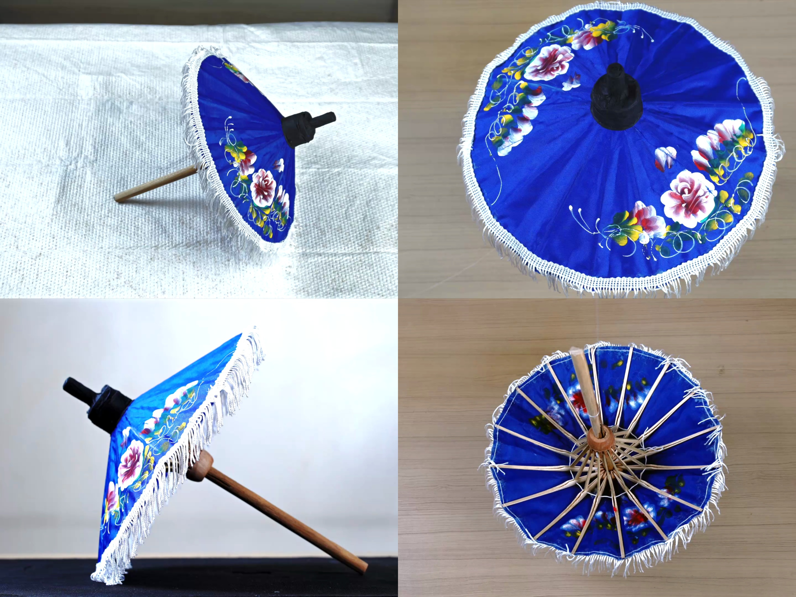
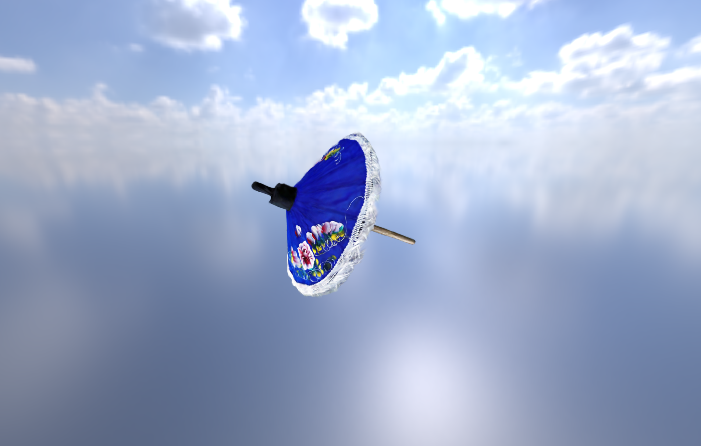

# Thai Parasol 3D Reconstruction (`thai-parasol-3d`)

A computer vision project for 3D reconstruction and digital preservation of traditional Thai handcrafted parasols using multi-view photogrammetry (**PyCOLMAP**), surface reconstruction (**Open3D**), **Dense MVS**, and neural rendering (**3D Gaussian Splatting** & **NeuS**).

## From multiple image into 3D model



## Gaussian splatting from multiple image into 3D model



## 📌 Quick Start

1. **Setup Environment:**

   ```bash
   python -m venv .venv
   source .venv/bin/activate
   pip install -r requirements.txt
   ```

   Or activate an existing virtual environment using:

   ```bash
   source run.sh
   ```

2. **Interactive Jupyter Notebooks:**
   - [**`notebooks/thai_parasol_3d_pipeline.ipynb`**] — End-to-end photogrammetry & mesh reconstruction workflow.
   - [**`notebooks/point_cloud.ipynb`**] — Point cloud inspection and visualization.
   - [**`notebooks/3dgs_mesh_extraction.ipynb`**] — Mesh extraction from 3D Gaussian Splatting outputs.
   - [**`notebooks/KAGGLE_DENSE_MVS_TRAINING.ipynb`**] — Dense Multi-View Stereo (MVS) training on Kaggle GPU.
   - [**`notebooks/KAGGLE_NEUS_TRAINING.ipynb`**] — NeuS (Neural SDF) training & watertight mesh export on Kaggle GPU.
   - [**`notebooks/packing.ipynb`**] — Dataset packaging helper notebook.

3. **Pipeline Overview (`src/`):**
   - **Stage 0 — Frame Extraction:** Extract high-density frames from multi-ring capture videos (`src/frame_extract.py`).
   - **Stage 1 — Preprocessing & Background Removal:** Resize images, filter blurry frames via Laplacian variance, and remove backgrounds using `rembg` (`src/preprocess.py`) or export transparent RGBA PNGs (`src/preprocess_png.py`).
   - **Stage 2 — SfM Reconstruction:** SIFT feature extraction, matching, and incremental Structure-from-Motion using PyCOLMAP (`src/reconstruct.py`).
   - **Stage 3 — Mesh Generation:** Statistical outlier removal, Screened Poisson reconstruction, and Taubin smoothing with Open3D for sparse (`src/mesh.py`) or dense MVS (`src/mesh_dense.py`) point clouds.
   - **Stage 4 — Neural Rendering (3DGS / NeuS):** Package COLMAP poses and masked images for Colab/Kaggle training (`src/package_neural_dataset.py`) and clean floating background artifacts from trained Gaussian splats (`src/clean_splat.py`).
   - **Stage 5 — Rendering & Visualization:** Studio turntable rendering (`src/render.py`), SIFT keypoint & match figures (`src/visualize_matches.py`), and multi-angle 1080p/4K point cloud & camera-pose exports (`src/export_pointcloud_images.py`).

---

## 📁 Repository Layout

```text
.
├── README.md                            # Main project documentation
├── requirements.txt                     # Python dependencies (opencv-python, numpy, open3d, pycolmap, Pillow, rembg)
├── run.sh                               # Helper script to activate .venv
├── PIPELINE.md                          # CLI pipeline documentation
├── CAPTURE_GUIDE.md                     # Photogrammetry & 4-ring capture guide
├── DENSE_MVS_AND_GPU_GUIDE.md           # Dense MVS & GPU execution guide
├── NEURAL_RENDERING_3DGS_NERF_GUIDE.md  # 3DGS & NeuS overview and cloud setup
├── COLAB_3DGS_AND_NEUS_GUIDE.md         # Colab 3DGS & NeuS guide
├── KAGGLE_NEUS_GUIDE.md                 # Kaggle NeuS training guide
├── PRESENTATION_SLIDES.md               # Presentation slides & timing guide
├── notebooks/
│   ├── thai_parasol_3d_pipeline.ipynb   # End-to-end photogrammetry notebook
│   ├── point_cloud.ipynb                # Point cloud exploration & visualization
│   ├── 3dgs_mesh_extraction.ipynb       # Mesh extraction from 3DGS
│   ├── KAGGLE_DENSE_MVS_TRAINING.ipynb  # Kaggle Dense MVS notebook
│   ├── KAGGLE_NEUS_TRAINING.ipynb       # Kaggle NeuS training notebook
│   └── packing.ipynb                    # Dataset packaging notebook
├── src/
│   ├── frame_extract.py                 # Stage 0: Video frame extraction
│   ├── preprocess.py                    # Stage 1: Resize, blur filter & rembg masking
│   ├── preprocess_png.py                # Stage 1 (Variant): Transparent RGBA PNG preprocessing
│   ├── reconstruct.py                   # Stage 2: PyCOLMAP feature extraction, matching & SfM
│   ├── mesh.py                          # Stage 3A: Sparse point cloud cleaning, Poisson mesh & Taubin smoothing
│   ├── mesh_dense.py                    # Stage 3B: Dense MVS point cloud meshing & color projection
│   ├── package_neural_dataset.py        # Stage 4A: Package COLMAP + images for 3DGS / NeuS
│   ├── clean_splat.py                   # Stage 4B: Post-process & clean 3DGS .ply splats
│   ├── render.py                        # Stage 5A: Open3D viewer & turntable rendering
│   ├── visualize_matches.py             # Stage 5B: SIFT keypoint & feature match plots
│   └── export_pointcloud_images.py      # Stage 5C: Multi-angle point cloud & camera-pose renders
└── outputs/
    ├── *.ply                            # Sparse, dense MVS, 3DGS splat, and reconstructed meshes
    ├── *.png                            # SIFT keypoint, feature match, and render figures
    ├── DENSE_MVS_RESULT/                # Dense MVS training outputs
    ├── mesh_from_3dgs/                  # Meshes extracted from 3DGS
    ├── renders_hd/                      # Full HD turntable renders
    ├── renders_sparse/                  # Dark-theme sparse point cloud & pose renders
    └── renders_sparse_white/            # White-theme sparse point cloud & pose renders
```
